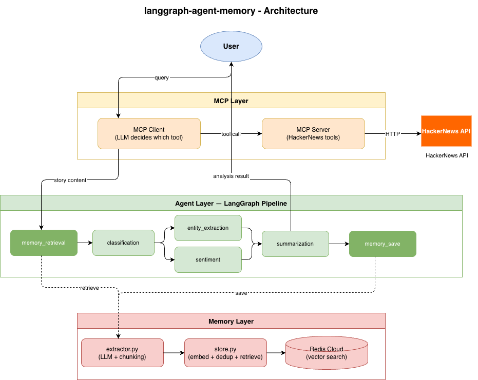

# LangGraph Agent Memory

一个基于 FastAPI、LangGraph、Groq LLM、Redis Vector Search 和 MCP 的文本分析 Agent 项目。项目提供同步与流式文本分析 API，并包含长期记忆模块，可通过语义检索让 Agent 在后续分析中复用用户偏好、历史上下文和已分析内容。



## 项目功能

### 1. 文本分析 Agent

核心能力由 LangGraph 编排，输入一段文本后自动完成：

- 文本分类：将文本归类为 `News`、`Blog`、`Research` 或 `Other`
- 实体抽取：对 `News` / `Research` 类型文本抽取人物、组织、地点等实体
- 情感分析：输出 `Positive`、`Negative` 或 `Neutral`
- 摘要生成：生成一句简洁摘要
- 条件路由：不同文本类别走不同处理分支
- 并行执行：实体抽取和情感分析可在图中并行执行

### 2. 长期记忆系统

项目内置长期记忆模块，用于保存和检索与用户相关的上下文信息：

- 从对话历史中抽取值得长期保存的信息
- 区分 `episodic` 与 `semantic` 两类记忆
- 使用 `sentence-transformers/all-MiniLM-L6-v2` 生成向量
- 使用 RedisVL / Redis Search 进行向量存储和语义检索
- 存储前执行相似记忆去重，减少重复内容
- 支持按 `user_id`、`thread_id`、`memory_type` 过滤记忆

当前 FastAPI 的 `/analyze` 接口只接收文本输入，未暴露 `user_id` 字段；因此通过 HTTP 接口调用时，记忆检索与保存会被跳过。MCP 客户端和直接调用 LangGraph Agent 时可以传入 `user_id` 使用记忆能力。

### 3. HTTP API 服务

项目提供 FastAPI 服务：

- `GET /health`：健康检查
- `POST /analyze`：同步文本分析
- `POST /analyze/stream`：基于 SSE 的流式文本分析
- 可选 API Key 鉴权：设置 `API_KEY` 后，请求需携带 `X-API-Key`

### 4. HackerNews MCP 集成

`mcp_hn` 模块实现了一个 HackerNews MCP Server 和 Client：

- 获取 HackerNews 热门故事
- 按关键词搜索 HackerNews 故事
- 根据 Story ID 获取故事内容
- 将获取到的故事内容接入文本分析 Agent

## 技术栈

| 类别 | 技术 |
| --- | --- |
| Web 框架 | FastAPI |
| ASGI 服务 | Uvicorn |
| Agent 编排 | LangGraph |
| LLM 框架 | LangChain / LangChain Core |
| 大模型服务 | Groq `llama-3.1-8b-instant` |
| 流式响应 | Server-Sent Events |
| 数据校验 | Pydantic |
| 环境变量 | python-dotenv |
| 长期记忆存储 | Redis |
| 向量检索 | RedisVL / Redis Search |
| Embedding 模型 | sentence-transformers `all-MiniLM-L6-v2` |
| ID 生成 | ULID |
| MCP | Model Context Protocol |
| 测试 | pytest / httpx / FastAPI TestClient |

## 项目特点

- 图式 Agent 编排：使用 LangGraph 将分析流程拆成多个节点，结构清晰，易于扩展。
- 条件执行：根据分类结果决定是否执行实体抽取，避免不必要的 LLM 调用。
- 支持流式输出：`/analyze/stream` 可按节点完成顺序返回结果，适合前端展示实时进度。
- 记忆增强：摘要节点可以读取相关长期记忆，使输出更贴近用户偏好和历史上下文。
- 语义记忆检索：通过向量相似度查找相关记忆，不依赖精确关键词匹配。
- MCP 扩展能力：通过 MCP Server 暴露 HackerNews 工具，并在 Client 中接入文本分析 Agent。
- 可选鉴权：本地开发可以不设置 `API_KEY`，生产环境可启用请求头鉴权。
- 模块边界清晰：API、Agent、Prompt、Memory、MCP、Test 分层明确。

## 能解决什么问题

本项目适合用于构建需要文本理解、结构化分析和上下文记忆能力的应用，例如：

- 新闻、博客、研究内容的自动分类和摘要
- 用户输入、客服工单、评论反馈的情感分析
- 从文章或消息中抽取关键实体
- 为内容平台构建实时分析接口
- 构建带长期记忆的个性化 Agent
- 分析 HackerNews 等外部信息源的热门内容
- 为前端产品提供同步或流式 AI 分析能力

## 项目结构

```text
.
|-- app/
|   |-- api/
|   |   |-- main.py              # FastAPI 入口、路由、鉴权、SSE 流式响应
|   |   `-- models.py            # API 请求和响应模型
|   |-- agent/
|   |   |-- graph.py             # LangGraph 图定义和节点路由
|   |   |-- state.py             # Agent 状态定义
|   |   `-- nodes/
|   |       |-- classification.py
|   |       |-- entity_extraction.py
|   |       |-- sentiment.py
|   |       |-- summarization.py
|   |       |-- memory_retrieval.py
|   |       `-- memory_save.py
|   |-- prompts/
|   |   |-- classification.py
|   |   |-- entity_extraction.py
|   |   |-- sentiment.py
|   |   `-- summarization.py
|   `-- tests/
|       |-- conftest.py
|       `-- test_api.py
|-- memory/
|   |-- extractor.py             # LLM 记忆抽取
|   |-- memory_manager.py        # 记忆系统统一入口
|   |-- models.py                # 记忆数据模型
|   `-- store.py                 # Redis 向量存储、检索、去重
|-- mcp_hn/
|   |-- mcp_server.py            # HackerNews MCP Server
|   `-- mcp_client.py            # MCP Client 与文本分析 Agent 集成
|-- assets/
|   |-- architecture.drawio
|   |-- architecture.png
|   |-- architecture.pdf
|   `-- architecture.svg
|-- requirements.txt
|-- .env.example
`-- README.md
```

## Agent 执行流程

```text
memory_retrieval
        |
classification_node
        |
  conditional routing
   /              \
News/Research   Blog/Other
   |              |
entity_extraction sentiment
   \              /
    summarization
        |
   memory_save
        |
       END
```

说明：

- 所有请求先进入 `memory_retrieval`。
- 分类结果为 `News` 或 `Research` 时，会执行实体抽取和情感分析。
- 分类结果为 `Blog` 或 `Other` 时，跳过实体抽取，只执行情感分析。
- 最后生成摘要，并尝试保存本次对话中的长期记忆。

## 环境要求

建议环境：

- Python 3.10+
- Redis Stack 或带 Redis Search / JSON 能力的 Redis
- Groq API Key

Redis 记忆模块会在导入时创建索引，并加载 `sentence-transformers/all-MiniLM-L6-v2` 模型。首次运行可能需要下载模型文件。

## 安装与配置

### 1. 创建虚拟环境

```bash
python -m venv .venv
```

Windows PowerShell：

```powershell
.\.venv\Scripts\Activate.ps1
```

macOS / Linux：

```bash
source .venv/bin/activate
```

### 2. 安装依赖

```bash
pip install -r requirements.txt
```

### 3. 配置环境变量

复制 `.env.example` 为 `.env`：

```bash
cp .env.example .env
```

Windows PowerShell：

```powershell
Copy-Item .env.example .env
```

`.env` 示例：

```env
GROQ_API_KEY=your_groq_api_key
REDIS_URL=redis://localhost:6379
API_KEY=optional_api_key
```

环境变量说明：

| 变量 | 必填 | 说明 |
| --- | --- | --- |
| `GROQ_API_KEY` | 是 | Groq 模型调用所需 API Key |
| `REDIS_URL` | 否 | Redis 连接地址，默认 `redis://localhost:6379` |
| `API_KEY` | 否 | FastAPI 可选鉴权密钥；设置后请求需携带 `X-API-Key` |

### 4. 启动 Redis

如果本地使用 Docker，可以启动 Redis Stack：

```bash
docker run -d --name redis-stack -p 6379:6379 redis/redis-stack:latest
```

### 5. 启动 API 服务

```bash
uvicorn app.api.main:api --reload
```

默认访问地址：

```text
http://127.0.0.1:8000
```

API 文档：

```text
http://127.0.0.1:8000/docs
```

## API 使用示例

### 健康检查

```bash
curl http://127.0.0.1:8000/health
```

响应示例：

```json
{
  "status": "ok",
  "message": "Service is running"
}
```

### 同步分析

```bash
curl -X POST http://127.0.0.1:8000/analyze \
  -H "Content-Type: application/json" \
  -d "{\"text\":\"OpenAI announced a new multimodal model in San Francisco.\"}"
```

启用 `API_KEY` 时：

```bash
curl -X POST http://127.0.0.1:8000/analyze \
  -H "Content-Type: application/json" \
  -H "X-API-Key: your_api_key" \
  -d "{\"text\":\"OpenAI announced a new multimodal model in San Francisco.\"}"
```

响应示例：

```json
{
  "classification": "News",
  "entities": "OpenAI, San Francisco",
  "sentiment": "Neutral",
  "summary": "OpenAI announced a new multimodal model in San Francisco."
}
```

### 流式分析

```bash
curl -N -X POST http://127.0.0.1:8000/analyze/stream \
  -H "Content-Type: application/json" \
  -d "{\"text\":\"OpenAI announced a new multimodal model in San Francisco.\"}"
```

响应格式为 SSE：

```text
data: {"node":"classification","result":"News"}

data: {"node":"entities","result":"OpenAI, San Francisco"}

data: {"node":"sentiment","result":"Neutral"}

data: {"node":"summary","result":"OpenAI announced a new multimodal model in San Francisco."}
```

## 直接调用 Agent

如果需要使用记忆能力，可以直接调用 LangGraph Agent 并传入 `user_id`：

```python
from app.agent.graph import agent

result = agent.invoke({
    "text": "OpenAI announced a new multimodal model in San Francisco.",
    "user_id": "user_123",
    "thread_id": "thread_001",
})

print(result)
```

## MCP HackerNews 使用方式

启动交互式 MCP Client：

```bash
python mcp_hn/mcp_client.py
```

示例问题：

```text
What are the top stories right now?
Search for stories about machine learning
Analyze story 12345
```

MCP Server 暴露的工具：

- `get_top_stories(limit)`：获取 HackerNews 热门故事
- `search_stories(query, limit)`：按关键词搜索故事
- `get_story_content(story_id)`：获取指定故事内容

## 运行测试

```bash
pytest
```

或只运行 API 测试：

```bash
pytest app/tests/test_api.py
```

注意：测试会导入真实 Agent，并依赖 Groq、Redis 和 embedding 模型初始化。如果本地没有配置 `GROQ_API_KEY` 或 Redis 服务不可用，相关测试可能失败。

## 开发扩展建议

- 在 `app/api/models.py` 中为请求模型增加 `user_id` 和 `thread_id`，让 HTTP API 也能完整使用长期记忆能力。
- 实现 `include_entities` 参数逻辑，允许调用方强制实体抽取。
- 将 LLM 模型名称、温度、记忆检索阈值等抽取为环境变量。
- 为 LLM 调用和 Redis 连接增加 mock，以便测试不依赖外部服务。
- 为 MCP Client 增加更严格的工具调用 JSON 校验和错误处理。
